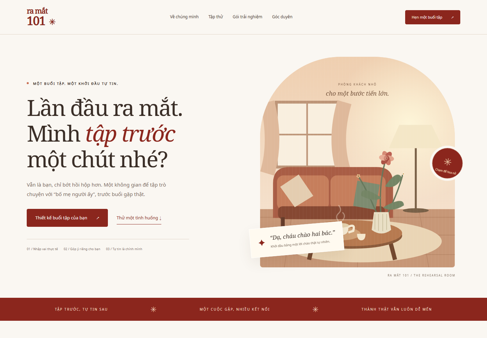

# Ra Mắt 101

Website giới thiệu dịch vụ luyện giao tiếp trước buổi gặp gia đình người yêu.

**Website:** https://ducvuongduy5-sketch.github.io/ra-mat-101/

## Tính năng
Animation hoa và phòng khách, luyện tình huống, bảng giá, form yêu cầu tư vấn, tarot 78 lá, cung hoàng đạo và checklist.

## Chạy và chỉnh sửa
Chạy `python -m http.server 5187` rồi mở http://localhost:5187. Không cần build hoặc API key. Sửa index.html, style.css, app.js và data.js. Tài nguyên và font nằm trong assets/. Không phụ thuộc CDN.

Form mở ứng dụng email hoặc tải TXT; chưa có backend nhận lịch/thanh toán. Tarot là bộ ngẫu nhiên độc lập dùng Web Crypto, không kết nối Familiar Tarot. Cung hoàng đạo phương Tây không phải lá số Tử Vi. Giá và địa điểm là đề xuất của nhóm.

## Thiết kế và quyền sử dụng
Minh họa SVG và mã giao diện được viết riêng. Cảm hứng tương tác hoa: https://github.com/IdeaToCodee/flowers-20-10 (không sao chép mã ứng dụng). Font Noto có giấy phép trong assets/fonts/LICENSE.txt. Chưa cấp giấy phép tái sử dụng cho mã website.

Đã kiểm tra desktop/mobile, form tư vấn, rút bài, checklist và reduced motion. GitHub Pages phục vụ main tại thư mục gốc.
